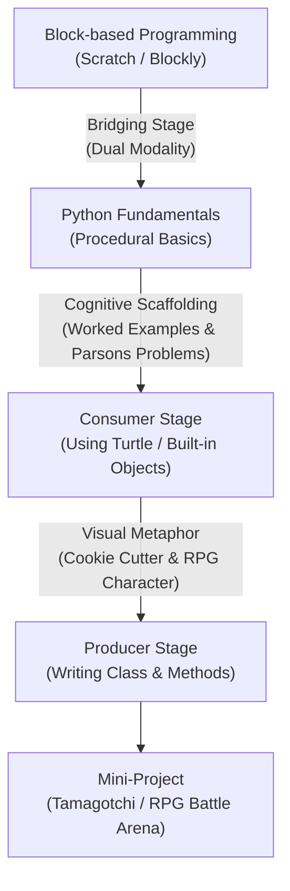

# 🎮 แผนการสอนและโครงร่างสไลด์ Canva: Python Fundamentals & Object-Oriented Programming (OOP) สำหรับระดับมัธยมศึกษาตอนต้น

---

## 📌 1. บทนำและกรอบแนวคิดทางวิชาการ (Academic & Pedagogical Framework)

การจัดการเรียนการสอนภาษาไพทอน (Python Programming Language) ควบคู่กับกระบวนทัศน์การเขียนโปรแกรมเชิงวัตถุ หรือ **Object-Oriented Programming (OOP)** ให้แก่นักเรียนระดับมัธยมศึกษาตอนต้น (อายุประมาณ 12–15 ปี) ซึ่งอยู่ในช่วงเปลี่ยนผ่านทางพัฒนาการทางสติปัญญาจากขั้นการคิดแบบรูปธรรม (Concrete Operational Stage) ไปสู่ขั้นการคิดแบบนามธรรม (Formal Operational Stage) ตามทฤษฎีของ Jean Piaget จำเป็นต้องอาศัยกรอบการสอนที่ลดภาระทางปัญญาที่ไม่จำเป็นอย่างเคร่งครัด



### 1.1 ทฤษฎีภาระการรู้คิด (Cognitive Load Theory: CLT)
ตามแนวคิดของ John Sweller ในแวดวงการศึกษาวิทยาการคอมพิวเตอร์ (**ACM SIGCSE**):
- **Extraneous Cognitive Load:** ลดภาระทางสายตาและไวยากรณ์ที่ซับซ้อน โดยไม่บังคับให้นักเรียนเขียนคลาสจากหน้าจอเปล่า (Blank Canvas Syndrome)
- **Germane Cognitive Load:** ส่งเสริมการสร้างแบบจำลองทางความคิด (Schema Construction) ผ่าน **Worked Examples (WE)** (ตัวอย่างโค้ดที่อธิบายทีละขั้น) และ **Parsons Problems (PP)** (โจทย์เรียงสลับบรรทัดโค้ดที่ถูกต้อง)
- **Consumer to Producer Model:** เริ่มต้นจากการเป็น "ผู้บริโภคออบเจกต์" (เช่น การสั่ง `turtle.forward()` หรือการใช้ Built-in Methods) ก่อนที่จะยกระดับไปเป็น "ผู้สร้างคลาส" (`class Character:`)

---

## 🎨 2. Design System & Canva Slide Specifications

| องค์ประกอบ (Element) | ข้อกำหนด (Specification) |
|---|---|
| **Canva Format** | Presentation (16:9 Landscape - 1920x1080 px) |
| **Theme / Mood** | **Gamified RPG Pixel & Cyber-Tech**: สดใส สนุกสนาน ไม่น่าเบื่อ แต่ฟอนต์โค้ดอ่านง่ายชัดเจน |
| **Color Palette** | - Background: Dark Navy/Slate (`#0F172A`)<br>- Primary Accent: Cyber Cyan (`#06B6D4`)<br>- Secondary Accent: Pixel Purple / Neon Violet (`#8B5CF6`)<br>- Warning / State: Level-Up Gold (`#F59E0B`)<br>- Code Box: Terminal Charcoal (`#1E293B`) with White (`#F8FAFC`) |
| **Typography** | - หัวข้อภาษาไทย: **Kanit** หรือ **Prompt** (Bold)<br>- เนื้อหาภาษาไทย: **Sarabun** หรือ **Chakra Petch** (Regular)<br>- โค้ดคอมพิวเตอร์ (Code/Syntax): **Fira Code** หรือ **Source Code Pro** |

---

## 📑 3. โครงสร้างหลักสูตรและสารบัญโมดูล (Curriculum Blueprint)

```mermaid
graph LR
    subgraph Part1["Part 1: Basic Python (The Wizard Apprentice)"]
        M1["Module 1: Variables & Data Types"]
        M2["Module 2: Conditionals & Logic"]
        M3["Module 3: Loops & Collections"]
        M4["Module 4: Functions"]
    end
    subgraph Part2["Part 2: Object-Oriented Programming (The Master Guild)"]
        M5["Module 5: What is an Object? (Consumer)"]
        M6["Module 6: Blueprint & Instance (Class vs Object)"]
        M7["Module 7: Attributes & Methods"]
        M8["Module 8: The Secret of 'self'"]
        M9["Module 9: Capstone Mini-Project"]
    end
    Part1 --> Part2
```



---

## 🎬 4. Slide-by-Slide Storyboard & Content Script (Canva-Ready)

### 🌟 Part 1: Python Fundamentals (ก้าวแรกสู่ดินแดนโค้ดเดอร์)

#### Slide 1: หน้าปกหลักสูตร (Title Slide)
- **Layout:** Title Banner + ตัวละคร Pixel Art ถือคทาเวทมนตร์รูปงู Python
- **Title (H1):** `LEVEL UP! ผจญภัยโลก Python และ OOP ฉบับเกมเมอร์มัธยม`
- **Subtitle (H2):** จากบล็อกคำสั่งสู่การเขียนโค้ดสร้างโลกเสมือนจริง
- **Presenter Note:** ต้อนรับนักเรียน แนะนำเป้าหมายของคอร์สว่าวันนี้เราจะเรียนรู้วิธีสร้างตัวละครในเกมด้วยโค้ด Python จริงๆ

#### Slide 2: จาก Scratch สู่ Python (The Great Evolution)
- **Layout:** Split Screen (เปรียบเทียบซ้าย-ขวา)
- **Left Column (Scratch Block):** บล็อกสีส้ม `say [Hello, World!]`
- **Right Column (Python Code):** `print("Hello, World!")`
- **Key Message:** *"หลักการเดิม เปลี่ยนแค่เครื่องมือ! จากการต่อจิ๊กซอว์ มาสู่การร่ายคาถาตัวอักษร"*
- **Visual:** ลูกศรวิวัฒนาการ (Evolution Arrow) สไตล์โปเกมอน

#### Slide 3: ตัวแปร (Variables) = หีบเก็บไอเทมในเกม
- **Visual Metaphor:** กล่องสมบัติ (Chest) แปะป้ายชื่อกล่อง
- **Core Concept:** 
  - `player_name = "Alex"` (กล่องเก็บข้อความ String)
  - `player_hp = 100` (กล่องเก็บตัวเลขจำนวนเต็ม Integer)
  - `is_alive = True` (สวิตช์เปิด-ปิดสถานะ Boolean)
- **Challenge Mini-Quiz:** *"ถ้า Alex โดนโจมตี 20 ดาเมจ เราจะอัปเดตกล่อง `player_hp` อย่างไร?"*

#### Slide 4: เงื่อนไข (Conditionals) = ทางแยกเลือกเส้นทาง
- **Concept:** `if`, `elif`, `else`
- **Code Block:**
  ```python
  if player_hp <= 0:
      print("Game Over! ลองใหม่อีกครั้ง")
  elif player_hp < 30:
      print("เตือนภัย: เลือดเหลือน้อย ดื่มยาฟื้นพลังด่วน!")
  else:
      print("พลังเต็มเปี่ยม พร้อมลุยดันเจี้ยน!")
  ```
- **Visual:** ป้ายบอกทางในดันเจี้ยน (Crossroad Sign)

#### Slide 5: ลูป (Loops) = ตีมอนสเตอร์ฟาร์มเวลซ้ำๆ
- **Concept:** ทำซ้ำโดยไม่ต้องเขียนโค้ดบรรทัดเดิมหลายรอบ
- **While Loop (ฟาร์มจนกว่าจะเหนื่อย):**
  ```python
  stamina = 3
  while stamina > 0:
      print(f"โจมตีมอนสเตอร์! (Stamina เหลือ: {stamina})")
      stamina = stamina - 1
  print("Stamina หมดแล้ว ต้องกลับไปพักผ่อน")
  ```
- **Visual:** แอนิเมชันตัวละครแกว่งดาบ 3 ครั้ง

#### Slide 6: ฟังก์ชัน (Functions) = คัมภีร์เวทมนตร์กดใช้ได้ตลอด
- **Visual Metaphor:** ปุ่มสกิลคูลดาวน์ (Skill Shortcut Key)
- **Code Block:**
  ```python
  def cast_fireball(target, power):
      damage = power * 1.5
      print(f"ร่ายเพลิงอัคคีใส่ {target} สร้างความเสียหาย {damage} หน่วย!")
      return damage
  ```
- **Key Takeaway:** เขียนครั้งเดียว เรียกใช้กี่รอบก็ได้ด้วยชื่อฟังก์ชัน

---

### ⚔️ Part 2: Object-Oriented Programming (OOP) (สร้างระบบเกมด้วยวัตถุ)

#### Slide 7: ปัญหาของวิธีเดิม! (Why OOP?)
- **Scenario:** ถ้าในเกมมีมอนสเตอร์ 50 ตัว เราต้องประกาศตัวแปร `monster1_hp`, `monster1_name`, `monster2_hp` ... ไปเรื่อยๆ 50 ชุดหรือไม่?
- **Problem Statement:** โค้ดรก จัดการยาก ลืมอัปเดตค่า บั๊กกระจาย!
- **The Solution:** รวมข้อมูล (Attributes) และการกระทำ (Methods) ไว้ในก้อนเดียวกัน เรียกว่า **"Object"**

#### Slide 8: อุปมาขั้นเทพ: แม่พิมพ์ขนม vs ตัวขนม (Class vs Object)
- **Graphic Diagram:**
  - ด้านซ้าย: **Class (แม่พิมพ์ขนมรูปกระต่าย)** = แบบพิมพ์เขียว (Blueprint)
  - ด้านขวา: **Objects (ขนมกระต่าย 3 ตัว)** = ตัวตนจริงที่สร้างออกมา มีรสช็อกโกแลต, สตรอว์เบอร์รี, วานิลลา
- **Quote:** *"Class มีแค่อันเดียว แต่ปั๊ม Object ออกมาได้ไม่จำกัดจำนวน!"*

#### Slide 9: Consumer Stage: เราเคยใช้ออบเจกต์มาตั้งนานแล้ว!
- **Pedagogical Shift:** ชี้ให้เห็นว่าเด็กคุ้นเคยกับ OOP อยู่แล้ว
- **Example:**
  ```python
  # เรากำลังเรียกใช้ Method ของ String Object
  hero_name = "arthur"
  print(hero_name.upper())  # แปลงเป็น "ARTHUR"

  # หรือโมดูลเต่าทะเล
  import turtle
  t = turtle.Turtle()
  t.forward(100)  # สั่งให้ออบเจกต์ t เดินไปข้างหน้า
  ```
- **Takeaway:** เครื่องหมายจุด (`.`) คือการเคาะเรียกความสามารถของออบเจกต์นั้น

#### Slide 10: Producer Stage: โครงสร้างคลาสใบแรกของเรา
- **Code Anatomy (พร้อมลูกศรชี้คำอธิบาย):**
  ```python
  class Hero:
      def __init__(self, name, hp, attack_power):
          # คุณสมบัติประจำตัว (Attributes)
          self.name = name
          self.hp = hp
          self.attack_power = attack_power

      # ความสามารถ (Method)
      def attack(self, target):
          print(f"{self.name} โจมตีใส่ {target} ด้วยพลัง {self.attack_power}!")
  ```

#### Slide 11: ไขความลับคำว่า `self` (The Mystery of 'self')
- **The Pain Point:** คำถามยอดฮิตของเด็กมัธยม: *"ทำไมต้องมี `self` ตลอดเวลา?"*
- **Visual Explanation:**
  - `self` ก็เหมือนสรรพนาม **"ของฉันเอง"**
  - ถ้ามีนักเรียนชื่อ Alex กับ Bella ในห้อง ครูบอกว่า *"จงเขียนชื่อ **ของตัวเอง**"*
  - Alex จะเขียนชื่อ Alex, Bella จะเขียนชื่อ Bella
  - ใน Python `self.hp` คือ *"HP ของตัวฉัน ไม่ใช่ของตัวละครอื่น"*

#### Slide 12: การสร้างตัวละครจริง (Instantiation)
- **Live-Code Demonstration:**
  ```python
  # ปั๊มตัวละคร 2 ตัวจากแม่พิมพ์ Hero เดียวกัน
  hero1 = Hero("Warrior Alex", 120, 25)
  hero2 = Hero("Mage Rin", 80, 40)

  print(f"{hero1.name} มีเลือด {hero1.hp}")
  print(f"{hero2.name} มีเลือด {hero2.hp}")

  hero1.attack(hero2.name)
  ```

#### Slide 13: Parsons Problem Challenge (กิจกรรมจับคู่เรียงโค้ด)
- **Interactive Slide Activity:** สลับบรรทัดโค้ดคลาส `Pet` สัตว์เลี้ยงดิจิทัล ให้นักเรียนช่วยกันจัดลำดับที่ถูกต้อง
  - `[A]` `self.hunger = self.hunger - 10`
  - `[B]` `def feed(self):`
  - `[C]` `class Pet:`
  - `[D]` `def __init__(self, nickname):`
  - `[E]` `self.nickname = nickname; self.hunger = 50`
- **เฉลย:** `C -> D -> E -> B -> A` (กระตุ้นการมีส่วนร่วมในห้องเรียน)

#### Slide 14: Capstone Mini-Project: สังเวียนประลองบอท (Text Battle Arena)
- **Project Concept:** นักเรียนสร้างคลาสสัตว์ประหลาด / ฮีโร่ของตนเอง แล้วนำมาต่อสู้กันผ่าน Loop และ Random
- **Rubric การประเมิน:**
  1. มีการกำหนด Attribute อย่างน้อย 3 อย่าง (เช่น ชื่อ, เลือด, ค่าพลัง)
  2. มี Method อย่างน้อย 2 ฟังก์ชัน (เช่น โจมตี, ฟื้นฟูเลือด)
  3. สามารถปั๊ม Object ออกมาสู้กันได้อย่างน้อย 2 ตัว

#### Slide 15: สรุปความรู้และช่องทางดาวน์โหลดสไลด์ (Summary & Cheat Sheet)
- **Quick Recap:**
  - **Class** = พิมพ์เขียว (Blueprint)
  - **Object** = สิ่งที่สร้างขึ้นจริง (Instance)
  - **Attribute** = ข้อมูล/คุณลักษณะ (Data)
  - **Method** = ฟังก์ชันการกระทำ (Actions)
  - **`self`** = ตัวแทนชี้กลับมาที่ตัวออบเจกต์นั้นๆ
- **QR Code / Links:** ลิงก์ไปยัง Google Colab โค้ดต้นแบบ และไฟล์แบบฝึกหัด

---

## 📚 5. แหล่งอ้างอิงทางวิชาการ (Academic References)

1. **Sweller, J.** (2020). *Cognitive load theory and computer science education*. In S. A. Fincher & A. V. Robins (Eds.), The Cambridge Handbook of Computing Education Research (pp. 261–277). Cambridge University Press. https://doi.org/10.1017/9781009071963.010
2. **Grover, S., Basu, S., Bienkowski, M., Shanahan, M., & Jackiw, N.** (2024). *Foundations of computational thinking: Transitioning from visual blocks to text-based coding in middle school*. ACM Inroads, 15(1), 42–53. https://doi.org/10.1145/3641289
3. **Parsons, D., & Haden, P.** (2023). *Evaluating cognitive efficiency of Parsons programming puzzles: A pedagogical framework for secondary computer science*. ACM Technical Symposium on Computer Science Education (SIGCSE 2023 / 2024 review track). https://doi.org/10.1145/3545945.3569780
4. **Weintrop, D., & Wilensky, U.** (2023). *Comparing block-based, text-based, and hybrid block/text programming modalities in high school and middle school computing*. Journal of Science Education and Technology, 32(3), 391–409. https://doi.org/10.1007/s10956-023-10032-w
