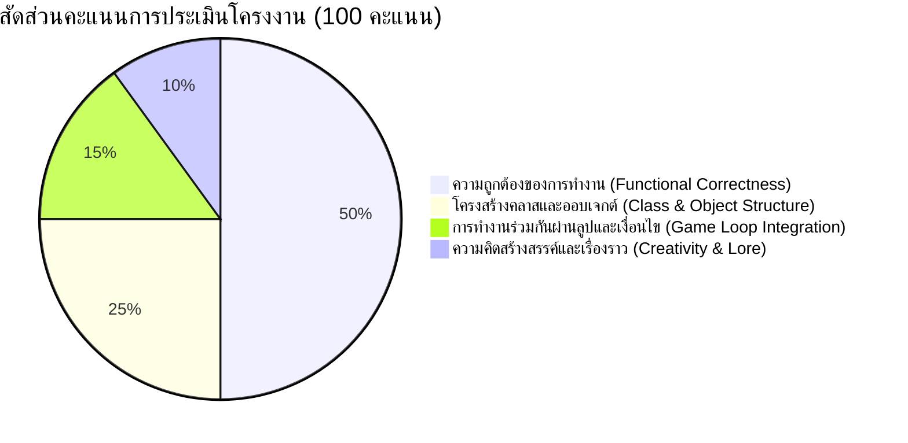
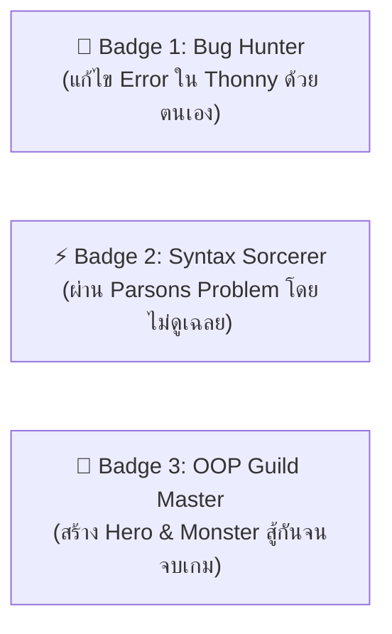
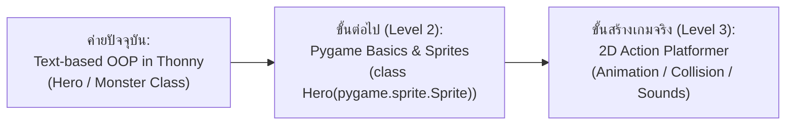

# 🎖️ คู่มือเกณฑ์ประเมินโครงงาน, สเปกเข็มกลัด Achievement Badges และเส้นทางต่อยอด (Post-Camp Roadmap)

---

## 🎯 1. เกณฑ์การประเมินโครงงาน Capstone Mini-Project (Text Battle Arena)
**เป้าหมายหลัก:** มุ่งเน้นความถูกต้องของการทำงาน (Functional Correctness) ตามแนวคิดของ **Cognitive Load Theory (CLT)** โดยเน้นให้ผู้เรียนเข้าใจกลไกและไม่มีข้อผิดพลาดทางไวยากรณ์

### เกณฑ์การให้คะแนนแบบละเอียด (Rubric Matrix)

| มิติการประเมิน (Dimensions) | ดีเยี่ยม (Master: 9–10 คะแนน) | ปานกลาง (Apprentice: 6–8 คะแนน) | ต้องปรับปรุง (Novice: 1–5 คะแนน) |
|---|---|---|---|
| **1. Functional Correctness (50 คะแนน)** | โปรแกรมรันผ่านฉลุยใน Thonny IDE โดยไม่เกิด Runtime Error ใดๆ เลยตลอดการเล่นตั้งแต่เริ่มจนจบ | โปรแกรมรันได้เกือบสมบูรณ์ มี Error เล็กน้อย 1 จุด แต่นักเรียนสามารถแก้ไขได้ด้วยตนเอง | โปรแกรมค้างหรือเกิด Error หยุดการทำงาน และไม่สามารถรันเกมลูปต่อเนื่องได้ |
| **2. Class & Object Architecture (25 คะแนน)** | มีการสร้าง Class พร้อม `__init__`, กำหนด Attributes ไม่น้อยกว่า 3 ตัว และเรียกใช้ `self` ถูกต้อง 100% | มี Class และ `__init__` แต่เขียน `self` ตกหล่นบางจุด หรือสร้าง Object ได้เพียงตัวเดียว | โครงสร้างยังเป็นแบบ Procedural ล้วน ไม่ปรากฏการใช้ Class และ Object |
| **3. Method & Interaction (15 คะแนน)** | มี Methods สำหรับการกระทำอย่างน้อย 2 ฟังก์ชัน (เช่น `attack()`, `take_damage()`) และส่งผ่าน Object ระหว่างกันได้ | มี Method เพียง 1 ฟังก์ชัน หรือการคำนวณลอจิกลดเลือดยังไม่แม่นยำ | ไม่มี Method มีเพียงการปรับค่า Attribute แบบตรงๆ จากภายนอก |
| **4. Clean Code & Lore (10 คะแนน)** | จัดย่อหน้า (Indentation) สะอาด สื่อความหมายตัวละครสนุกสนาน มีข้อความบอกสถานะชัดเจน | โค้ดทำงานได้แต่ชื่อตัวแปรสับสน หรือข้อความการต่อสู้แสดงผลติดกันอ่านยาก | ย่อหน้าไม่สม่ำเสมอ หรือไม่ใส่คอมเมนต์อธิบายการทำงาน |

---

## 🏅 2. สเปกการออกแบบเข็มกลัด/สติกเกอร์เกียรติยศ (Achievement Badges for Canva)

> **การนำไปสร้างใน Canva:** ใช้เทมเพลต **Badge / Round Sticker (ขนาด 500x500 px หรือ 2x2 นิ้ว)** สไตล์ Pixel Art นีออน เพื่อพิมพ์แจกหรือแปะบนแฟ้มผลงานของนักเรียน

### รายละเอียดเข็มกลัด 3 ระดับ:

#### 1. 🐞 ตราสัญลักษณ์: Bug Hunter (นักล่าบั๊ก)
- **เงื่อนไขการได้รับ:** นักเรียนที่พบข้อผิดพลาด (เช่น `IndentationError` หรือ `AttributeError`) แล้วใช้หน้าต่าง Shell และ Variables ใน Thonny แก้ไขได้สำเร็จด้วยตนเอง
- **Canva Design Prompts:**
  - Shape: วงกลมขอบเฟืองจักรกลสีบรอนซ์ทอง
  - Icon: แมลงเรืองแสงสีเขียวที่มีเครื่องหมายกากบาทถูกขีดฆ่าด้วยแว่นขยาย
  - Text: `BUG HUNTER` | `Thonny Detective`
  - Color Theme: Lime Green (`#10B981`) & Dark Slate (`#1E293B`)

#### 2. ⚡ ตราสัญลักษณ์: Syntax Sorcerer (จอมเวทไวยากรณ์)
- **เงื่อนไขการได้รับ:** นักเรียนหรือทีมที่สามารถจัดเรียงการ์ดกิจกรรม **Parsons Problems** ได้ถูกต้องครบทุกใบเป็นกลุ่มแรกๆ โดยไม่ติดปัญหาเรื่องลำดับตรรกะ
- **Canva Design Prompts:**
  - Shape: โล่รูปดาวห้าแฉกขอบนีออนสีฟ้า
  - Icon: คทาเวทมนตร์ปลายสายฟ้าที่มีวงเล็บปีกกาและโคลอน `{ : }`
  - Text: `SYNTAX SORCERER` | `Code Arranger`
  - Color Theme: Electric Blue (`#3B82F6`) & Cyber Cyan (`#06B6D4`)

#### 3. 👑 ตราสัญลักษณ์สูงสุด: OOP Guild Master (ปรมาจารย์แห่งกิลด์ OOP)
- **เงื่อนไขการได้รับ:** สร้างชิ้นงาน Mini-Project (Text Battle Arena) ได้สมบูรณ์ตามเกณฑ์ Functional Correctness และสามารถนำตัวละครไปดวลกับบอสบนจอใหญ่ได้สำเร็จ
- **Canva Design Prompts:**
  - Shape: มงกุฎทองคำประดับอัญมณีสีม่วงเรืองแสง
  - Icon: ดาบไขว้คู่กับโล่ มีตัวอักษร OOP สลักอยู่ตรงกลาง
  - Text: `OOP GUILD MASTER` | `Class & Object Legend`
  - Color Theme: Royal Gold (`#F59E0B`) & Neon Purple (`#8B5CF6`)

---

## 🚀 3. แผนการต่อยอดหลังจบค่าย (Post-Camp Pathway: Python to 2D Pygame)

เพื่อให้การเรียนรู้ไม่สิ้นสุดเพียงแค่ตัวอักษรในเทอร์มินัล แต่ต่อยอดสู่การเห็นภาพกราฟิกขยับได้จริงในระดับมัธยมศึกษาตอนปลาย

### การเชื่อมโยงความรู้ (Pedagogical Bridge):
1. **จาก `self.hp` สู่ `self.rect`:** 
   - ในค่ายนี้นักเรียนเข้าใจแล้วว่า `self.hp` คือตัวแปรประจำตัวของตัวละคร
   - เมื่อขยับไป **Pygame** นักเรียนจะพบว่าตัวละครจะมี `self.image` (รูปภาพกราฟิก) และ `self.rect` (ตำแหน่งพิกัด X, Y บนหน้าจอ) ซึ่งใช้หลักการเดียวกับคลาส `Hero` ทุกประการ!
2. **จาก `player.attack()` สู่ `sprite.update()`:**
   - การสั่งให้ตัวละครขยับ หรือโจมตี ก็คือการเรียกใช้ Method ประจำออบเจกต์ใน Game Loop ของ Pygame
3. **แหล่งเรียนรู้และซอฟต์แวร์แนะนำต่อยอด:**
   - คลังไลบรารี: **Pygame-CE (Community Edition)** หรือ **Arcade Library**
   - แหล่งดาวน์โหลดกราฟิกฟรีสำหรับนักเรียน: Kenney.nl (Pixel Assets สไตล์ CC0 ไม่ติดลิขสิทธิ์)
