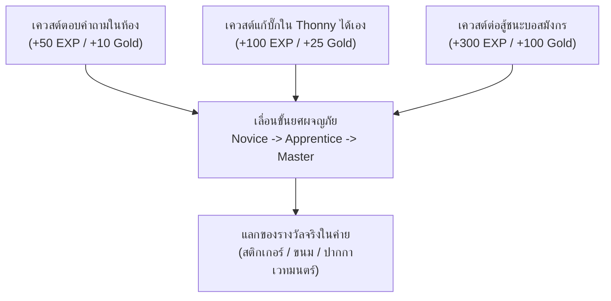
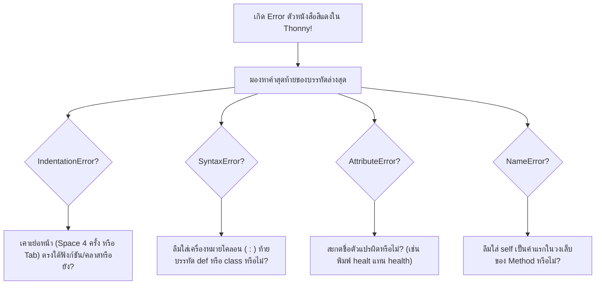

# 🎨 ชุดออกแบบสื่อ Canva: บัตรแถบโค้ด Parsons Problems, ระบบแต้ม EXP & Gold และคู่มือแก้บั๊ก A4

---

## 📑 สารบัญชุดสื่อการจัดพิมพ์ (Printable Assets Directory)
1. **ระบบเกมมิฟิเคชัน: EXP & Gold Token System (สมุดกิลด์สะสมแต้ม)**
2. **แม่แบบบัตรแถบโค้ด Parsons Problems (Color-Coded Strips for Canva)**
3. **ใบสรุปคู่มือแก้บั๊ก Top 5 Common Errors (A4 Quick Reference Poster)**

---

## 🪙 1. ระบบเกมมิฟิเคชัน: EXP & Gold Token System (สมุดกิลด์สะสมแต้ม)

> **รูปแบบสื่อบน Canva:** ใบภารกิจขนาด A5 (Guild Adventurer Pass) พิมพ์หน้า-หลัง เพื่อให้นักเรียนพกติดตัวตลอดค่าย 2 วัน



### ตารางเลเวลและฉายาในค่าย:
| ระดับ (Level) | ค่า EXP สะสม | ฉายาประจำตัว (Guild Rank) | สิทธิพิเศษ/รางวัล |
|---|---|---|---|
| **Lv. 1** | 0 – 199 EXP | **Code Novice** (ผู้ฝึกหัดเขียนโค้ด) | ป้ายชื่อประจำโต๊ะ + ดินสอเวทมนตร์ |
| **Lv. 2** | 200 – 499 EXP | **Syntax Squire** (อัศวินไวยากรณ์) | สติกเกอร์โฮโลแกรม "Bug Hunter" |
| **Lv. 3** | 500 – 899 EXP | **Class Knight** (อัศวินแห่งพิมพ์เขียว) | โพชั่นขนมหวานเพิ่มพลังสมอง |
| **Lv. 4 (MAX)** | 900+ EXP | **OOP Guild Master** (มหาจอมเวท OOP) | เข็มกลัดเกียรติยศ + ใบประกาศนียบัตรทองคำ |

---

## 🃏 2. แม่แบบบัตรแถบโค้ด Parsons Problems (Color-Coded Strips)

> **หลักการลดภาระทางปัญญา (Cognitive Load Theory: CLT):** การใช้สีแยกแยะประเภทของโค้ด (Syntax Highlighting บนกระดาษ) ช่วยให้นักเรียนมัธยมต้นมองเห็นความสัมพันธ์ของบล็อกโค้ดได้ทันที

### โค้ดสีประจำประเภทบล็อก (Color Palette System):
- 🟦 **สีฟ้าคราม (Cyan `#0EA5E9`):** ประกาศหัวข้อหลัก (`class`, `def __init__`, `def`)
- 🟩 **สีเขียวมิ้นต์ (Emerald `#10B981`):** การกำหนดค่าตัวแปรคุณสมบัติ (`self.name = ...`, `self.hp = ...`)
- 🟧 **สีส้มอิฐ (Amber `#F59E0B`):** เงื่อนไขและการตัดสินใจ (`if`, `else`)
- 🟪 **สีม่วงพาสเทล (Purple `#8B5CF6`):** การแสดงผลและการคำนวณ (`print(...)`, `self.hp - damage`)

---

### ✂️ บัตรพิมพ์ชุดกิจกรรม: "กำเนิดอัศวิน Arthur" (Printable Code Strips)

```text
┌────────────────────────────────────────────────────────────────────────────────────────┐
│ [แถบสีฟ้า]   class Hero:                                                                │
├────────────────────────────────────────────────────────────────────────────────────────┤
│ [แถบสีฟ้า]       def __init__(self, name, hp, attack_power):                           │
├────────────────────────────────────────────────────────────────────────────────────────┤
│ [แถบสีเขียว]         self.name = name                                                  │
├────────────────────────────────────────────────────────────────────────────────────────┤
│ [แถบสีเขียว]         self.hp = hp                                                      │
├────────────────────────────────────────────────────────────────────────────────────────┤
│ [แถบสีเขียว]         self.attack_power = attack_power                                  │
├────────────────────────────────────────────────────────────────────────────────────────┤
│ [แถบสีฟ้า]       def attack(self, target):                                             │
├────────────────────────────────────────────────────────────────────────────────────────┤
│ [แถบสีม่วง]          damage = self.attack_power                                        │
├────────────────────────────────────────────────────────────────────────────────────────┤
│ [แถบสีม่วง]          print(f"{self.name} โจมตีใส่ {target} สร้างความเสียหาย {damage}!") │
├────────────────────────────────────────────────────────────────────────────────────────┤
│ [แถบสีส้ม]       def is_alive(self):                                                   │
├────────────────────────────────────────────────────────────────────────────────────────┤
│ [แถบสีม่วง]          return self.hp > 0                                                │
└────────────────────────────────────────────────────────────────────────────────────────┘
```
**คำแนะนำการใช้งาน:**
1. ตัดตามเส้นประเป็นแถบยาวขนาด 18 x 3 ซม.
2. ติดแถบแม่เหล็กยางด้านหลัง (Rubber Magnet Strip) สำหรับให้นักเรียนนำมาแปะเรียงบนกระดานไวท์บอร์ดหน้าห้อง
3. สลับลำดับแถบการ์ดก่อนแจกให้นักเรียนในแต่ละกลุ่ม

---

## 🛠️ 3. ใบสรุปคู่มือแก้บั๊ก Top 5 Common Errors (A4 Infographic Poster)

> **การนำไปสร้างใน Canva:** ใช้เทมเพลต **Infographic / Flyer (ขนาด A4 แนวตั้ง - 210 x 297 mm)** พิมพ์ 4 สีเคลือบพลาสติกวางประจำเครื่องคอมพิวเตอร์ทุกเครื่อง



### เนื้อหา Infographic 5 ช่องตารางสำหรับ Canva:

#### ช่องที่ 1: `IndentationError` (บั๊กย่อหน้าเบี้ยว)
- **ภาพประกอบ:** ไม้บรรทัดวัดระยะย่อหน้า
- **ข้อความบนโปสเตอร์:** *"โค้ดที่อยู่ใต้ `class` หรือ `def` ต้องเยื้องเข้าไปทางขวา 1 แท็บเสมอ! ถ้าเบี้ยวแม้แต่ช่องเดียว Python จะอ่านไม่รู้เรื่อง"*

#### ช่องที่ 2: `SyntaxError` (บั๊กคาถาตกหล่น)
- **ภาพประกอบ:** แว่นขยายส่องเครื่องหมาย `:` เรืองแสง
- **ข้อความบนโปสเตอร์:** *"ท่องไว้ให้ขึ้นใจ! หลังคำว่า `class ชื่อคลาส:` หรือ `def ชื่อฟังก์ชัน():` ต้องมีเครื่องหมายจุดคู่ (Colon `:`) ปิดท้ายเสมอ"*

#### ช่องที่ 3: `AttributeError` (บั๊กหาหีบสมบัติไม่เจอ)
- **ภาพประกอบ:** กล่องสมบัติที่มีเครื่องหมายคำถามลอยขึ้นมา
- **ข้อความบนโปสเตอร์:** *"มักเกิดจากพิมพ์ตัวสะกดภาษาอังกฤษผิด เช่น ใน `__init__` ตั้งชื่อว่า `self.hp` แต่ตอนเรียกใช้เผลอพิมพ์ `hero.healt` ตรวจเช็กตัวอักษรพิมพ์เล็ก-ใหญ่ให้ตรงกัน"*

#### ช่องที่ 4: `NameError: name 'self' is not defined` (บั๊กไร้ตัวตน)
- **ภาพประกอบ:** กระจกเงาสะท้อนตัวละคร
- **ข้อความบนโปสเตอร์:** *"เมธอดในคลาสทุกตัว ต้องมี `self` อยู่ในวงเล็บเป็นตัวแรกเสมอ เช่น `def attack(self, target):` ห้ามลืมเด็ดขาด!"*

#### ช่องที่ 5: `TypeError: missing argument` (บั๊กวัตถุดิบไม่ครบ)
- **ภาพประกอบ:** แม่พิมพ์ขนมที่ขาดแป้งและน้ำตาล
- **ข้อความบนโปสเตอร์:** *"ถ้า `__init__(self, name, hp)` มีพารามิเตอร์ 2 ตัว ตอนสร้างออบเจกต์ต้องส่งค่าให้ครบ 2 อย่าง เช่น `Hero('Arthur', 100)`"*
