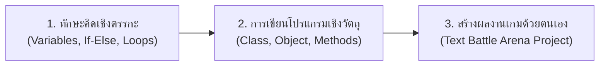

# 📰 จดหมายข่าวสรุปผลการเรียนรู้สำหรับผู้ปกครอง (Parent Learning Recap Newsletter)
**โครงการ:** ค่ายเยาวชนนักสร้างสรรค์โค้ดมัธยมต้น (Young Python & OOP Coding Camp)  
**ขนาดสื่อแนะนำบน Canva:** แผ่นพับ/จดหมายข่าวขนาด A4 แนวตั้ง (210 x 297 mm) พิมพ์ 4 สี พับครึ่งหรือแจกหน้าเดียว

---

## 🌟 ข้อความพาดหัวหลัก (Main Headline)
> ### "ขอแสดงความยินดีกับนักผจญภัยรุ่นเยาว์! บรรลุหลักสูตรพื้นฐาน Python และการเขียนโปรแกรมเชิงวัตถุ (OOP)"

---

## 🎯 1. สิ่งที่บุตรหลานของท่านได้เรียนรู้และลงมือทำจริง (What They Achieved)

ตลอดระยะเวลาการเข้าค่ายอบรมเชิงปฏิบัติการเข้มข้น 12 ชั่วโมง บุตรหลานของท่านไม่ได้เป็นเพียง "ผู้ใช้งานเกม" แต่ได้ก้าวสู่การเป็น **"ผู้สร้างสรรค์เทคโนโลยี (Technology Creator)"** ผ่านภาษาไพทอน (Python Programming Language) ซึ่งเป็นหนึ่งในภาษาคอมพิวเตอร์ที่มีความต้องการสูงที่สุดในโลกยุคปัญญาประดิษฐ์

### สรุป 4 องค์ความรู้สำคัญที่นักเรียนได้ฝึกฝน:
1. **การคิดเชิงคำนวณและโครงสร้างตรรกะ (Computational Thinking):**
   - การจัดการข้อมูลผ่านตัวแปร (Variables), การสร้างทางเลือกในการตัดสินใจ (Conditionals) และการสั่งทำซ้ำ (Loops)
2. **การเขียนโปรแกรมเชิงวัตถุ (Object-Oriented Programming: OOP):**
   - ความเข้าใจในสถาปัตยกรรมซอฟต์แวร์ระดับสากล ผ่านอุปมา **"แม่พิมพ์ขนม (Class)"** และ **"ตัวขนมจริง (Object)"**
3. **การแก้ปัญหาอย่างเป็นระบบ (Systematic Debugging):**
   - ฝึกอ่านข้อความแจ้งเตือนข้อผิดพลาด (Error Messages) บนโปรแกรม Thonny IDE และแก้ไขปัญหาด้วยตนเองโดยไม่ท้อถอย
4. **การประยุกต์ใช้ในโครงการจริง (Hands-on Mini-Project):**
   - พัฒนาระบบต่อสู้จำลอง **"Text Battle Arena"** บนคอมพิวเตอร์ของตนเองแบบเดี่ยว 100% ตั้งแต่บรรทัดแรกจนทำงานได้สมบูรณ์

---

## 🏆 2. ช่องกรอกข้อมูลและสติกเกอร์เกียรติยศประจำตัวนักเรียน (Personal Showcase)

| ข้อมูลนักเรียน | รายละเอียดผลงานประจำค่าย |
|---|---|
| **ชื่อ-นามสกุล:** | ด.ช. / ด.ญ. ..................................................................... |
| **ชื่อตัวละครฮีโร่ที่สร้าง:** | ........................................................................................... |
| **สเตตัสตัวละคร (HP / ATK):** | เลือด: .................... แต้ม / พลังโจมตี: .................... แต้ม |
| **ระดับยศที่ทำได้ในค่าย:** | 🔲 Novice &nbsp;&nbsp; 🔲 Squire &nbsp;&nbsp; 🔲 Knight &nbsp;&nbsp; 🔲 OOP Guild Master |
| **เหรียญเกียรติยศที่ได้รับ:** | 🔲 Bug Hunter &nbsp;&nbsp; 🔲 Syntax Sorcerer &nbsp;&nbsp; 🔲 Best Coder Award |

*(พื้นที่สำหรับติดสติกเกอร์ Badge ดวงกลมขนาด 2 นิ้วที่นักเรียนได้รับจากคุณครู)*

---

## 🚀 3. คำแนะนำในการส่งเสริมและต่อยอดที่บ้าน (Next Steps for Parents)

1. **ส่งเสริมการทดลองรันโค้ดต่อที่บ้าน:**
   - โปรแกรม **Thonny IDE** เป็นโปรแกรมฟรีและปลอดภัย สามารถดาวน์โหลดติดตั้งบนเครื่องคอมพิวเตอร์ที่บ้านได้จาก `https://thonny.org`
   - โค้ดเกมที่นักเรียนเขียนในค่ายถูกบันทึกไว้ในไฟล์ `starter_battle_arena.py` นักเรียนสามารถนำไปเปิดเล่นและปรับแต่งเพิ่มความสามารถได้
2. **ก้าวต่อไปในระดับมัธยมปลาย:**
   - ความรู้เรื่อง Class และ Object ในค่ายนี้ คือพื้นฐานสำคัญสำหรับการสร้างเกมภาพเคลื่อนไหว 2 มิติด้วยไลบรารี **Pygame** และการศึกษาต่อในสาขาวิทยาการคอมพิวเตอร์ ปัญญาประดิษฐ์ (AI) และวิศวกรรมซอฟต์แวร์

---

> *"การเขียนโปรแกรมไม่ได้สอนเพียงแค่วิธีการสั่งงานคอมพิวเตอร์ แต่สอนวิธีคิดอย่างมีแบบแผนและการไม่ยอมแพ้ต่ออุปสรรค"*  
> **— ทีมวิทยากรและผู้จัดค่าย Young Python Coder**
