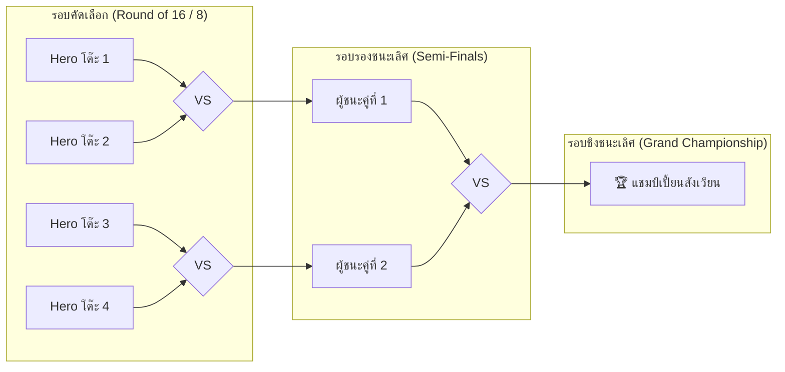

# ⚔️ คู่มือการจัดกิจกรรมการแข่งขัน Live Arena Tournament (Showcase & Demo Day)

---

## 🏆 วัตถุประสงค์ของกิจกรรม
เพื่อให้นักเรียนได้นำออบเจกต์ตัวละคร `Hero` ที่ตนเองเขียนขึ้นแบบเดี่ยว (1 คนต่อ 1 เครื่อง) มาทดสอบประลองความสามารถจริงในสังเวียนใหญ่บนจอโปรเจกเตอร์หน้าชั้นเรียน สร้างบรรยากาศความสนุกสนาน ส่งเสริมความภาคภูมิใจในผลงาน และตอกย้ำความเข้าใจในกลไกของ **Object-Oriented Programming (OOP)**

---

## 📋 1. โครงสร้างการแข่งขันและสายประลอง (Tournament Bracket)



### กติกาการแข่งขัน (Arena Rules):
1. **งบประมาณค่าสเตตัส (Fair Balance Stat Cap):**
   - เพื่อความยุติธรรม ทุกคนต้องตั้งค่าพลังโดยมีขอบเขตจำกัด:
     - พลังชีวิต (`hp`) ไม่เกิน 150 แต้ม
     - พลังโจมตี (`attack_power`) ไม่เกิน 25 แต้ม
     - ค่าสุ่มบวก-ลบดาเมจไม่เกิน 5 แต้ม
2. **การนำโค้ดขึ้นเวที:**
   - ครูผู้สอนเปิดไฟล์ `tournament_runner.py` บนเครื่องแม่ข่ายที่ต่อจอโปรเจกเตอร์
   - นักเรียนสลับกันเดินออกมาพิมพ์ชื่อตัวละครและสเตตัสของตนเองลงในฟังก์ชันสร้าง Object:
     ```python
     hero_player1 = Hero(name="Arthur_Table3", hp=120, attack_power=20)
     hero_player2 = Hero(name="Shadow_Table7", hp=100, attack_power=24)
     ```

---

## 🎙️ 2. สคริปต์ผู้ดำเนินรายการ/ผู้บรรยายเกม (Caster Script for Facilitators)

| ช่วงเวลาการแข่ง | ตัวอย่างบทพากย์ของผู้สอน/ผู้ช่วยสอน | กิจกรรมบนหน้าจอ |
|---|---|---|
| **เปิดสังเวียน** | *"ขอต้อนรับเหล่านักผจญภัยเข้าสู่สังเวียนแห่งเกียรติยศ! ฮีโร่ที่ทุกคนเห็นบนจอโปรเจกเตอร์นี้ ถูกสร้างขึ้นจากหยาดเหงื่อและโค้ด Python ของพวกเราทุกคน มาดูกันว่าพิมพ์เขียวของใครจะแข็งแกร่งที่สุดในวันนี้!"* | เปิดเพลงประกอบ 8-bit จังหวะตื่นเต้น และฉายหน้าจอสแตนด์บาย |
| **แนะนำผู้เข้าแข่งขัน** | *"มุมแดง จากโต๊ะหมายเลข 3 ส่ง 'Arthur' อัศวินเกราะหนัก เลือด 120 เข้าประกวด! และมุมน้ำเงิน จากโต๊ะหมายเลข 7 ส่ง 'Shadow Ninja' เลือด 100 แต่พลังโจมตีสูงถึง 24 แต้ม!"* | โชว์โค้ดบรรทัดสร้าง Object ของทั้ง 2 โต๊ะ |
| **ระหว่างการต่อสู้ (Game Loop)** | *"เทิร์นที่ 1 มาแล้ว! Arthur พุ่งเข้าไปฟัน ทำดาเมจ 21 แต้ม! Shadow Ninja สวนกลับทันควันด้วยเปลวเพลิง 23 แต้ม! เลือดลดลงทั้งคู่แล้วครับท่านผู้ชม!"* | โค้ดใน Shell ค่อยๆ เลื่อนแสดงผลทีละเทิร์นตามจังหวะ `time.sleep(1)` |
| **จบการดวล** | *"และแล้ว... ดาเมจสุดท้าย 25 แต้มทำให้ Shadow Ninja พ่ายแพ้ไป! ผู้ชนะในแมตช์นี้คือ Arthur จากโต๊ะหมายเลข 3 รับเหรียญทองเพิ่มอีก 100 Gold เข้ากระเป๋าไปเลยครับ!"* | เสียงปรบมือทั้งห้อง มอบสติกเกอร์ Badge ประจำรอบ |

---

## 🛠️ 3. โค้ดสำหรับเครื่องแม่ข่ายจัดทัวร์นาเมนต์ (`tournament_runner.py`)

```python
import sys
import time
import random

# รองรับการแสดงผลภาษาไทยและสัญลักษณ์บน Windows Terminal
if sys.stdout.encoding and sys.stdout.encoding.lower() != 'utf-8':
    try:
        sys.stdout.reconfigure(encoding='utf-8')
    except Exception:
        pass

# สามารถ Import คลาส Hero ของนักเรียนจาก starter_battle_arena.py หรือใช้คลาสนี้ได้โดยตรง
class TournamentHero:
    def __init__(self, name, hp, attack_power):
        self.name = name
        # ระบบ Fair Balance Stat Clamp ป้องกันนักเรียนใส่สเตตัส 999999
        self.max_hp = min(hp, 150)
        self.hp = self.max_hp
        self.attack_power = min(attack_power, 25)

    def attack(self, enemy):
        """ชื่อเมธอดตรงกับโค้ดของนักเรียน 100%"""
        damage = max(0, self.attack_power + random.randint(-4, 4))
        print(f"💥 [{self.name}] โจมตีใส่ [{enemy.name}] สร้างดาเมจ {damage} แต้ม!")
        enemy.take_damage(damage)

    def take_damage(self, damage):
        """ชื่อเมธอดตรงกับโค้ดของนักเรียน 100%"""
        damage = max(0, damage)
        self.hp = max(0, self.hp - damage)
        print(f"🛡️ [{self.name}] HP เหลือ: {self.hp}/{self.max_hp}")

    def is_alive(self):
        return self.hp > 0

def run_match(hero1, hero2):
    print("\n" + "=" * 55)
    print(f"       🥊 การประลอง: {hero1.name} VS {hero2.name} 🥊")
    print("=" * 55)

    # สุ่มเลือกว่าใครจะได้เริ่มโจมตีก่อนเพื่อความยุติธรรม (Coin Flip)
    first_attacker, second_attacker = (hero1, hero2) if random.choice([True, False]) else (hero2, hero1)
    print(f"🎲 เหรียญนำโชคออก! [{first_attacker.name}] ได้สิทธิ์เริ่มโจมตีก่อน!\n")
    time.sleep(1)

    turn = 1
    while hero1.is_alive() and hero2.is_alive():
        print(f"--- 🌀 TURN {turn} ---")
        first_attacker.attack(second_attacker)
        time.sleep(1)
        if not second_attacker.is_alive():
            print(f"\n🏆 ผู้ชนะการแข่งขัน: [{first_attacker.name}] ยินดีด้วยครับ! 🏆")
            break
            
        second_attacker.attack(first_attacker)
        time.sleep(1)
        if not first_attacker.is_alive():
            print(f"\n🏆 ผู้ชนะการแข่งขัน: [{second_attacker.name}] ยินดีด้วยครับ! 🏆")
            break

        turn = turn + 1
```
